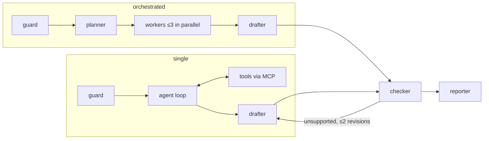

# agent-service (C9)

Investigation API: FastAPI + LangGraph, two agent modes, an evidence ledger and a code-first claim
checker. Contracts: `docs/specs/contracts.md` §4 and §6, `docs/implementation-notes.md` §7.

## How it works



1. **Guard** classifies the question; out-of-scope or purchase advice ends as `refused` (FR-AGT-10).
2. **Single mode** runs one tool-calling loop over every MCP tool. **Orchestrated mode** has a planner
   emit a validated `Plan` (one repair attempt, FR-AGT-4) and workers that may only use the tools of
   their task kind (data → fleet, stats → stats, literature → docs).
3. **Every tool call goes through the ledger** (FR-AGT-5): the result envelope is stored in `evidence`
   under `ev_` + 16 hex of sha256(investigation|seq|tool|args), and a step row is streamed over SSE.
   Tool output reaches the model only inside fenced data blocks (NFR-SEC-2).
4. The **drafter** writes claims whose numbers are `NumberRef`s: value, unit, evidence ID, JSON path.
5. The **checker** (ADR-008) resolves each path in the cited evidence and compares in code: 0.5%
   relative or 0.01 absolute for percentages/ratios/p-values, exact for counts and drive-days, units
   must match. Failing claims go back to the drafter at most twice, then land in `unverified` and never
   in the summary (FR-AGT-6/7).
6. The **reporter** builds the `Report` JSON and Markdown and adds the dataset caveats that apply.

Budget guards (tool calls, input tokens, wall time) stop a run with a partial report and status
`budget_exceeded` (FR-AGT-8).

## LLM provider ($0, ADR-013)

One provider interface (ADR-010) over any OpenAI-compatible endpoint, with retries honoring 429
`Retry-After`. While `COHORTEX_MONTHLY_LLM_CAP_USD=0`, only free hosts are accepted (Groq, localhost,
Ollama). `COHORTEX_LLM_MODE=record` saves request/response pairs to `evals/recordings/`;
`replay` serves them so CI never calls a live model.

```bash
# Groq free tier
LLM_BASE_URL=https://api.groq.com/openai/v1 LLM_MODEL=openai/gpt-oss-20b LLM_API_KEY=... uv run python -m cohortex_agent
# Local Ollama
LLM_BASE_URL=http://localhost:11434/v1 LLM_MODEL=gpt-oss:20b LLM_API_KEY=ollama uv run python -m cohortex_agent
```

Tests: `uv run pytest services/agent-service` (real Postgres, scripted LLM; `test_integration_mcp.py`
runs against the real MCP servers).
